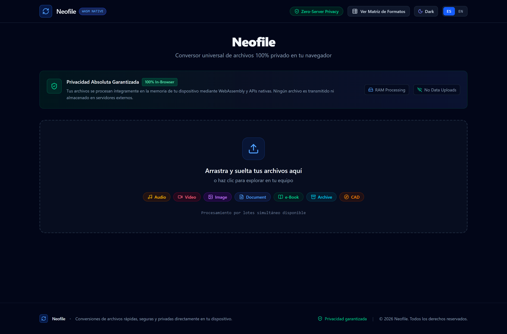
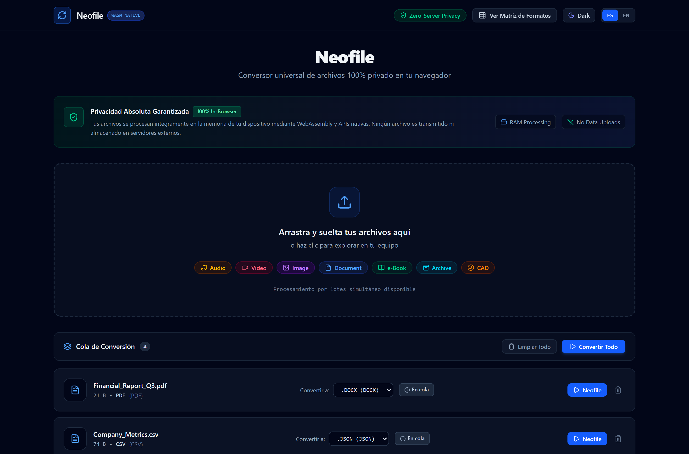
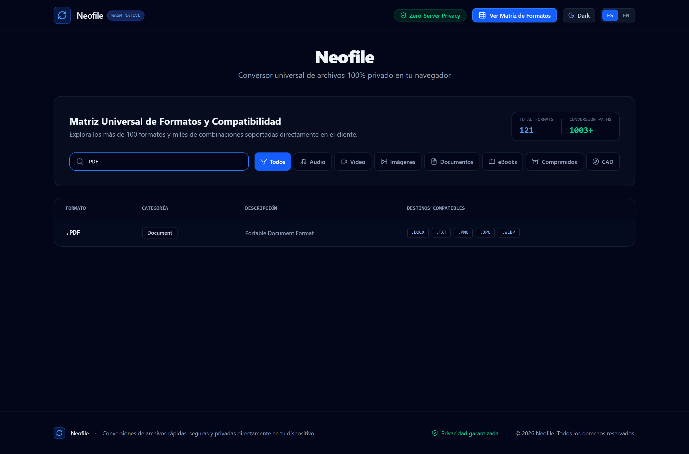

# Neofile - Universal Converter (Zero-Server) / Conversor Universal Zero-Server

> Navigation / Navegación:  
> [English Version](#english-version) | [Versión en Español](#versión-en-español) | [Architecture](docs/ARCHITECTURE.md) | [Commit Guidelines](docs/CONVENTIONAL_COMMITS.md) | [Privacy Guarantee](docs/PRIVACY_ZERO_SERVER.md)

---

<a id="english-version"></a>
## English Version

### Overview
**Neofile** is a universal file conversion platform with 100% client-side processing using **WebAssembly (WASM)**, **Web Workers**, and **Hexagonal Architecture (Ports & Adapters)**.

Your files **are never uploaded to any server**. Total privacy is guaranteed by processing everything within the browser's local memory.

### Screenshots and Visual Walkthrough

#### 1. Main Screen & Dropzone
Clean, distraction-free interface with instant drag-and-drop file ingestion, privacy indicators, and batch upload support.



#### 2. Batch Conversion Queue
Concurrent processing with state-locked target selectors, real-time progress indicators, and individual or ZIP bundle downloads.



#### 3. Format Compatibility Explorer
Interactive lookup to explore valid conversion routes and compatible output formats across 100+ file extensions.



---

### Key Highlights

- **Absolute Privacy (Zero-Server)**: No backend receives files. Zero bytes transmitted to external networks.
- **100+ Formats Supported**: Covers full categories of Audio, Video, Images, Structured Data, Documents, eBooks, Archives, and CAD.
- **Data & DevTools Transformation Engine**: Instant bidirectional conversions between `JSON`, `YAML`, `XML`, `CSV`, `TSV`, `SQL`, `Markdown`, `HTML`, `Excel`, and `Base64` encode/decode.
- **Hexagonal Architecture**: Pure domain core decoupled from UI frameworks and conversion engine adapters.
- **Batch Processing**: Simultaneous conversions with concurrency management, common target selector, and ZIP bundling.
- **Reconversion & Compression Ratio**: In-memory target switching without re-uploading and real-time size reduction metrics.
- **Theme Selector**: Light, Dark, and System Auto modes.
- **Binary Format Detection**: Identifies file types via binary *Magic Numbers* instead of relying solely on file extensions.
- **Zero Emoji Standard**: Clean, professional typography with structured SVG iconography (Lucide Icons).
- **Bilingual Internationalization**: Native English and Spanish support with persistent segmented language selector.
- **Dual Test Strategy**: Domain unit tests alongside automated QA integration test suite with 20 tests.

---

### Supported Formats by Category

| Category | Available Formats |
| :--- | :--- |
| **Audio** | `3GA`, `AAC`, `AC3`, `AIFF`, `FLAC`, `M4A`, `M4R`, `MIDI`, `MP3`, `OGG`, `RA`, `RAM`, `WAV`, `WMA` |
| **Video** | `3G2`, `3GP`, `3GPP`, `ASF`, `AVI`, `FLV`, `GVI`, `M4V`, `MKV`, `MOD`, `MOV`, `MP4`, `MPG`, `MTS`, `RM`, `RMVB`, `TS`, `VOB`, `WEBM`, `WMV` |
| **Images** | `AI`, `AVIF`, `BMP`, `CDR`, `EMF`, `GIF`, `HEIC`, `JFIF`, `JPG`, `JPEG`, `ODG`, `PCX`, `PNG`, `PSD`, `SVG`, `TGA`, `TIFF`, `WBMP`, `WEBP`, `WMF`, `ICO` |
| **Documents & Data** | `B64`, `CSV`, `DJVU`, `DOC`, `DOCM`, `DOCX`, `EML`, `EPS`, `HTML`, `JSON`, `MD`, `MSG`, `ODP`, `ODS`, `ODT`, `PDF`, `PPS`, `PPSX`, `PPT`, `PPTM`, `PPTX`, `PS`, `PUB`, `RTF`, `SQL`, `TEX`, `TSV`, `TXT`, `WKS`, `WPD`, `WPS`, `XLR`, `XLS`, `XLSM`, `XLSX`, `XML`, `XPS`, `YAML`, `YML` |
| **e-Books** | `AZW`, `AZW3`, `CBC`, `CBR`, `CBZ`, `CHM`, `EPUB`, `FB2`, `LIT`, `LRF`, `MOBI`, `PDB`, `PML`, `PRC`, `RB`, `TCR` |
| **Archives** | `7Z`, `CAB`, `LZH`, `RAR`, `TAR`, `TAR.BZ2`, `TAR.GZ`, `YZ1`, `ZIP` |
| **CAD** | `DWG`, `DXF` |

---

### Hexagonal Architecture Structure

```
neofile/
├── src/
│   ├── core/                           # Domain Core & Application Use Cases (Pure TypeScript)
│   │   ├── domain/
│   │   │   ├── entities/               # Format, ConversionJob, FileItem, ConversionMatrix
│   │   │   ├── value-objects/          # ConversionOptions, ConversionProgress
│   │   │   └── ports/                  # IConversionEngine, IFormatDetector, ITelemetryPort
│   │   └── application/
│   │       ├── use-cases/              # ConvertFileUseCase, BatchConvertUseCase, DetectFormatUseCase
│   │       └── services/               # EngineRouterService
│   │
│   ├── infrastructure/                 # Output Adapters (Engine Implementations)
│   │   └── adapters/
│   │       ├── engines/                # ImageConversionAdapter, DocumentEngineAdapter, etc.
│   │       ├── detectors/              # MagicNumberDetectorAdapter
│   │       └── telemetry/              # LocalConsoleTelemetryAdapter
│   │
│   └── presentation/                   # Primary Adapter (React 19 + TailwindCSS)
│       ├── components/                 # Dropzone, Queue, MatrixExplorer, Navbar, Footer
│       ├── context/                    # ConversionContext, I18nContext
│       └── i18n/                       # ES / EN dictionaries
│
├── tests/
│   ├── unit/                           # Domain unit tests
│   └── qa/                             # Automated integration QA test runner
└── docs/                               # Bilingual technical documentation
```

---

### Quickstart

#### Prerequisites
- Node.js 20+ (tested on v26.3.0)
- npm 10+

#### Commands
```bash
# Install dependencies
npm install

# Start development server
npm run dev

# Run Master & QA Test Suite
npm run test:qa

# Build production bundle
npm run build
```

---

<a id="versión-en-español"></a>
## Versión en Español

### Visión General
**Neofile** es una plataforma de conversión universal de archivos con procesamiento 100% en el cliente mediante **WebAssembly (WASM)**, **Web Workers** y **Arquitectura Hexagonal (Ports & Adapters)**.

Tus archivos **nunca se suben a ningún servidor**. La privacidad es absoluta y todo el procesamiento se realiza en la memoria local del navegador.

### Capturas de Pantalla y Vista Previa

#### 1. Pantalla Principal y Zona de Carga
Interface minimalista y limpia con selector de arrastrar y soltar, estadísticas de privacidad y soporte multitarea.


#### 2. Cola de Conversión por Lotes
Gestión simultánea de conversiones con bloqueo de selector tras procesar, control de progreso individual y descargas automáticas (incluyendo paquetes ZIP para PDFs multipágina).


#### 3. Explorador de Compatibilidad de Formatos
Buscador interactivo para consultar todas las combinaciones y rutas de conversión disponibles entre más de 100 formatos.


---

### Características Principales

- **Privacidad Total (Zero-Server)**: Sin backend que reciba archivos. Cero bytes transmitidos a servidores externos.
- **Más de 100 Formatos Soportados**: Cubre categorías completas de Audio, Video, Imágenes, Documentos, Datos estructurados, eBooks, Comprimidos y CAD.
- **Motor de Datos y DevTools**: Transformación bidireccional instantánea entre `JSON`, `YAML`, `XML`, `CSV`, `TSV`, `SQL`, `Markdown`, `HTML`, `Excel` y codificación/decodificación `Base64`.
- **Arquitectura Hexagonal**: Núcleo de dominio desacoplado de frameworks e implementaciones de motores de conversión.
- **Procesamiento por Lotes**: Conversión simultánea con control de concurrencia, selector masivo común y descarga individual o en ZIP.
- **Reconversión y Comparativa de Peso**: Posibilidad de cambiar el formato destino tras convertir y métricas de ahorro de tamaño.
- **Selector de Tema Visual**: Modos Claro, Oscuro y Automático del Sistema.
- **Detección Binaria**: Identificación de tipos de archivo mediante firmas *Magic Numbers* en lugar de basarse únicamente en la extensión.
- **Zero Emoji Standard**: Diseño profesional, limpio y tipográfico con iconografía SVG estructurada (Lucide Icons).
- **Internacionalización Bilingüe**: Soporte nativo para Español e Inglés con selector segmentado persistente.
- **Batería de Testeo Doble**: Tests unitarios de dominio y suite de 20 tests automáticos de integración.

---

### Formatos Soportados por Categoría

| Categoría | Formatos Disponibles |
| :--- | :--- |
| **Audio** | `3GA`, `AAC`, `AC3`, `AIFF`, `FLAC`, `M4A`, `M4R`, `MIDI`, `MP3`, `OGG`, `RA`, `RAM`, `WAV`, `WMA` |
| **Video** | `3G2`, `3GP`, `3GPP`, `ASF`, `AVI`, `FLV`, `GVI`, `M4V`, `MKV`, `MOD`, `MOV`, `MP4`, `MPG`, `MTS`, `RM`, `RMVB`, `TS`, `VOB`, `WEBM`, `WMV` |
| **Imágenes** | `AI`, `AVIF`, `BMP`, `CDR`, `EMF`, `GIF`, `HEIC`, `JFIF`, `JPG`, `JPEG`, `ODG`, `PCX`, `PNG`, `PSD`, `SVG`, `TGA`, `TIFF`, `WBMP`, `WEBP`, `WMF`, `ICO` |
| **Documentos & Datos** | `B64`, `CSV`, `DJVU`, `DOC`, `DOCM`, `DOCX`, `EML`, `EPS`, `HTML`, `JSON`, `MD`, `MSG`, `ODP`, `ODS`, `ODT`, `PDF`, `PPS`, `PPSX`, `PPT`, `PPTM`, `PPTX`, `PS`, `PUB`, `RTF`, `SQL`, `TEX`, `TSV`, `TXT`, `WKS`, `WPD`, `WPS`, `XLR`, `XLS`, `XLSM`, `XLSX`, `XML`, `XPS`, `YAML`, `YML` |
| **e-Books** | `AZW`, `AZW3`, `CBC`, `CBR`, `CBZ`, `CHM`, `EPUB`, `FB2`, `LIT`, `LRF`, `MOBI`, `PDB`, `PML`, `PRC`, `RB`, `TCR` |
| **Comprimidos**| `7Z`, `CAB`, `LZH`, `RAR`, `TAR`, `TAR.BZ2`, `TAR.GZ`, `YZ1`, `ZIP` |
| **CAD** | `DWG`, `DXF` |

---

### Instalación y Ejecución

#### Requisitos
- Node.js 20+ (probado en v26.3.0)
- npm 10+

#### Pasos
1. **Instalar dependencias**:
   ```bash
   npm install
   ```

2. **Iniciar servidor de desarrollo**:
   ```bash
   npm run dev
   ```

3. **Ejecutar tests unitarios y QA automático**:
   ```bash
   npm run test:qa
   ```

4. **Compilar para producción**:
   ```bash
   npm run build
   ```

---

## Licencia

Código abierto bajo la licencia MIT.
